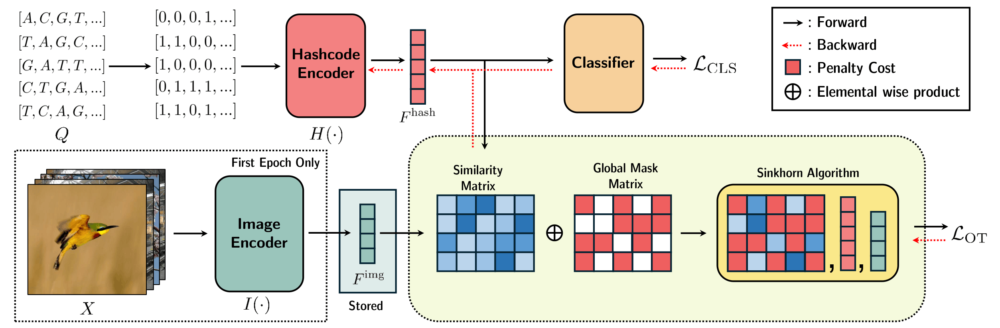

# PHM: Predefined Primer-Aware Hash Mapping for Image Retrieval

PHM maps images to a predefined, DNA-compatible quaternary codebook.
Biologically admissible DNA sequences are pseudo-labeled and refined before
a lightweight hash encoder is trained with class-guided optimal transport and
classification objectives.



This repository contains the implementation, experiment configurations,
dataset split files, and released codebooks accompanying the manuscript.

## 1. Installation

```bash
pip install -r requirements.txt
```

Python 3.10 or later and a CUDA-enabled PyTorch installation are recommended.

## 2. Quick Start

The following example runs PHM with a ViT backbone on CIFAR-10. Run all
commands from the repository root.

```bash
# Fine-tune the image encoder
python finetune_encoder.py \
    --backbone vit \
    --dataset cifar10 \
    --seed 42

# Extract image features
python extract_features.py \
    --backbone vit \
    --dataset cifar10

# Train PHM
python main.py \
    --config config/campaign/cifar_vit16.yaml \
    --mode train
```

The supplied configuration follows the experimental setting used in the
manuscript.

## 3. Data and Codebooks

### 3.1 Released Codebooks

The Set 1 codebooks used for training and evaluation are provided under
`codebooks/`.

| Dataset | Length | Codes | File |
|---|---:|---:|---|
| CIFAR-10 | 16 nt | 3,848 | `codebooks/set1_cifar10_16nt.csv` |
| CIFAR-10 | 32 nt | 938 | `codebooks/set1_cifar10_32nt.csv` |
| ImageNet-100 | 16 nt | 9,148 | `codebooks/set1_imagenet_16nt.csv` |
| ImageNet-100 | 32 nt | 7,676 | `codebooks/set1_imagenet_32nt.csv` |
| NUS-WIDE | 16 nt | 5,657 | `codebooks/set1_nuswide_16nt.csv` |
| NUS-WIDE | 32 nt | 3,315 | `codebooks/set1_nuswide_32nt.csv` |

The held-out Set 2 codesets are provided under `dataset/codeset/` and are
used only for evaluation.

The code representation, refinement settings, and generation commands are
described in [`CODEBOOKS.md`](CODEBOOKS.md).

### 3.2 Image Datasets

CIFAR-10 is downloaded automatically by the data loader. ImageNet-100 and
NUS-WIDE must be obtained separately.

| Dataset | Image directory | Split files |
|---|---|---|
| CIFAR-10 | `dataset/cifar10/` | handled by the data loader |
| ImageNet-100 | `dataset/imagenet/image/` | `dataset/imagenet/*.txt` |
| NUS-WIDE | `dataset/nuswide/images/` | `dataset/nuswide/setting1/*.txt` |

The included split files define the training, query, and retrieval-database
partitions used in the experiments.

### 3.3 Image Encoders and Features

PHM uses features extracted from a fine-tuned image backbone.

```bash
python finetune_encoder.py --backbone vit --dataset cifar10
python extract_features.py --backbone vit --dataset cifar10
```

Supported backbones are ViT, Swin Transformer, and EVA-Giant. Extracted
features are written to the paths specified in `utils/data_utils.py`.

## 4. Running the Main Experiments

Campaign configurations are located under `config/campaign/`.

```bash
# Train all dataset, backbone, and code-length configurations
python run_main_campaign.py --devices 0 1 2 3

# Train a selected subset
python run_main_campaign.py --devices 0 --only in_vit

# Evaluate trained checkpoints
python eval_main_campaign.py --device cuda:0
```

The evaluation script reports Set 1 and Set 2 mAP together with HDC. A
single experiment can also be run directly.

```bash
# Single-label datasets
python main.py \
    --config config/campaign/cifar_vit16.yaml \
    --mode train

# Multi-label dataset
python main_multi.py \
    --config config/campaign/nus_vit16.yaml \
    --mode train

# Evaluate a trained checkpoint
python main.py \
    --config config/campaign/cifar_vit16.yaml \
    --mode test \
    --model_path <checkpoint.pt>
```

## 5. Repository Structure

```text
main.py / main_multi.py     PHM training and evaluation
loss.py                     masked optimal-transport objectives
models.py                   hash encoders
tools.py                    pseudo-labeling and utility functions
gen_codebook_tl.py          codebook generation
clique.py                   deterministic greedy clique refinement
generate_pool.py            biologically constrained candidate generation
eval_codebook.py            codebook evaluation
run_main_campaign.py        main experiment campaign
eval_main_campaign.py       campaign evaluation
finetune_encoder.py         image-backbone fine-tuning
extract_features.py         image-feature extraction
CODEBOOKS.md                code representation and codebook generation
RESULTS.md                  reference outputs for the main campaign
config/campaign/            experiment configurations
codebooks/                  Set 1 codebooks
dataset/codeset/            candidate pools, anchors, and Set 2 codesets
dataset/imagenet/           ImageNet-100 split files
dataset/nuswide/setting1/   NUS-WIDE split files
data/features/              extracted image features
figures/                    framework diagram
utils/                      data loading, metrics, and scheduling
```

## 6. Additional Documentation

- [`CODEBOOKS.md`](CODEBOOKS.md): code representation and codebook generation
- [`RESULTS.md`](RESULTS.md): reference outputs for the main campaign
- `requirements.txt`: software environment
- `config/campaign/`: experiment configurations
- [`LICENSE`](LICENSE): MIT License

The supplied codebooks and configurations correspond to the experiments
reported in the manuscript. Re-fine-tuning an image backbone may introduce
small numerical variation.
